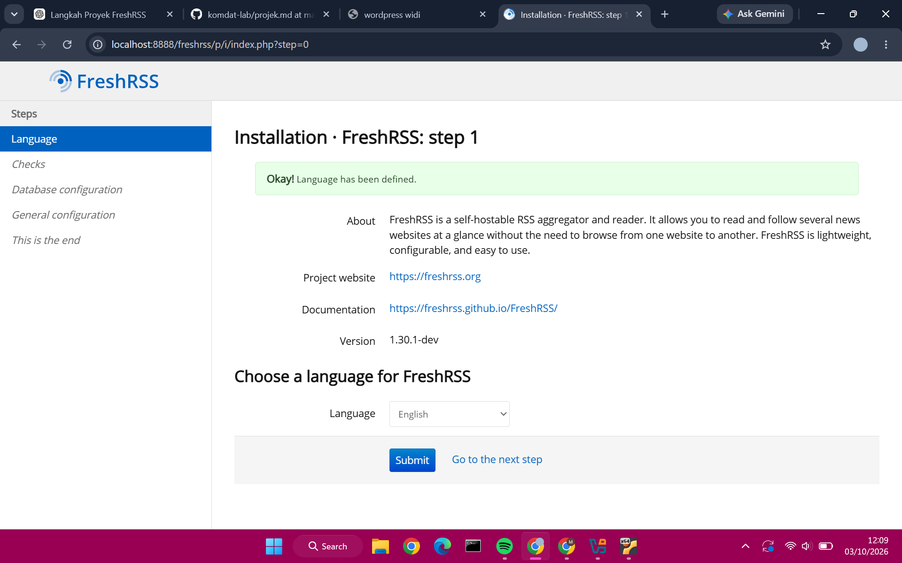
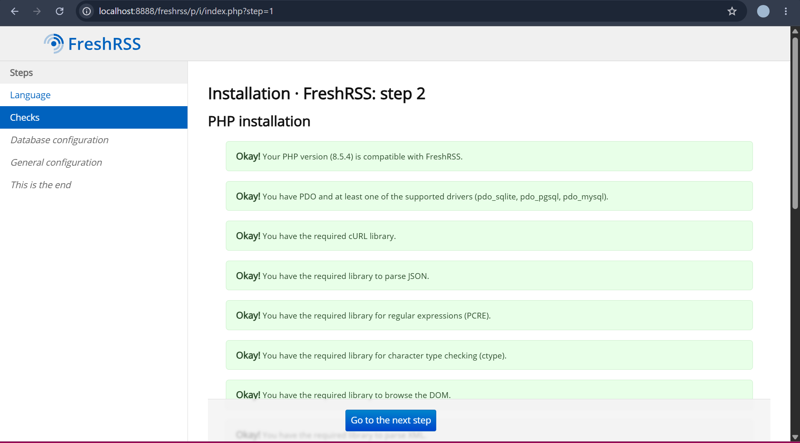
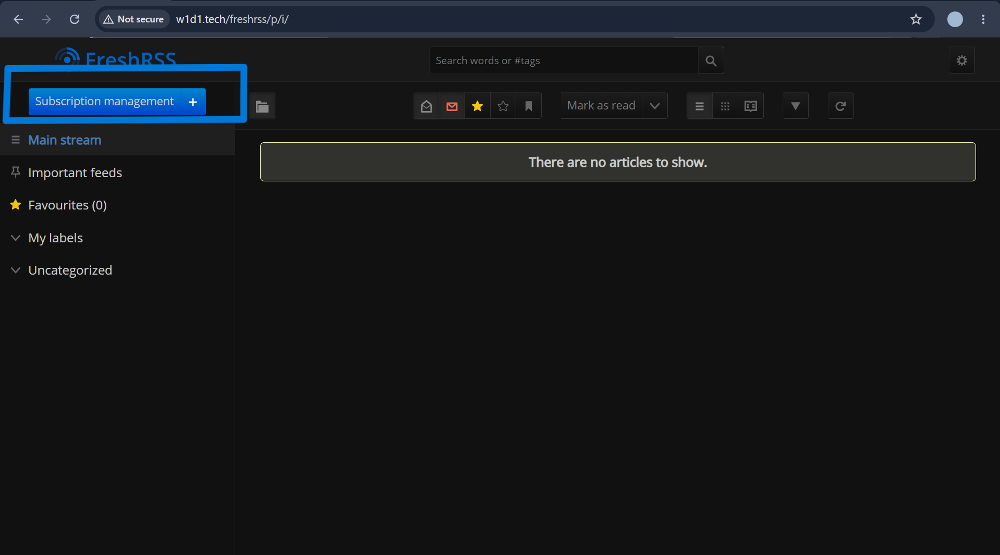
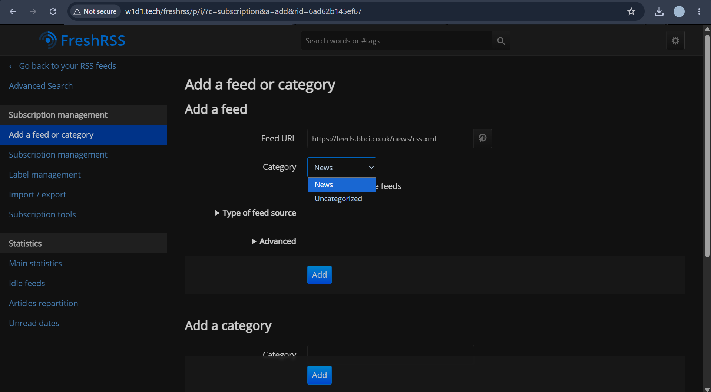

# FreshRSS

## Sekilas Tentang

FreshRSS merupakan aplikasi web *feed reader* berbasis sumber terbuka (*open-source*) yang digunakan untuk mengumpulkan, mengelola, dan membaca berita atau artikel dari berbagai situs web dalam satu tempat. Aplikasi ini memanfaatkan teknologi RSS (*Really Simple Syndication*) untuk mengambil pembaruan konten dari situs web yang menyediakan layanan RSS.

Dengan menggunakan FreshRSS, pengguna tidak perlu membuka setiap situs secara terpisah untuk mengetahui berita atau artikel terbaru. Pengguna cukup menambahkan alamat RSS dari situs yang diinginkan, kemudian membaca berbagai pembaruan tersebut melalui satu antarmuka aplikasi.

Dalam proyek ini, FreshRSS dipilih sebagai aplikasi web yang diimplementasikan untuk memenuhi tugas mata kuliah Komunikasi Data dan Jaringan. Instalasi dilakukan pada lingkungan virtual menggunakan Ubuntu sebagai sistem operasi server, Apache sebagai *web server*, PHP sebagai lingkungan pemrosesan aplikasi, serta MySQL sebagai basis data.

Pengujian awal dilakukan dengan menjalankan FreshRSS melalui browser pada lingkungan lokal. Aplikasi kemudian digunakan untuk menambahkan umpan RSS BBC News World sehingga artikel berita dapat ditampilkan dan dibaca melalui antarmuka FreshRSS. Tahap selanjutnya mencakup penyelesaian dokumentasi, pemilihan layanan hosting gratis, dan pengujian akses aplikasi melalui jaringan internet.


## Instalasi

### Prasyarat

Sebelum melakukan instalasi FreshRSS, diperlukan beberapa perangkat lunak dan komponen pendukung agar aplikasi dapat berjalan dengan baik. Pada proyek ini, instalasi dilakukan menggunakan lingkungan virtual dengan spesifikasi sebagai berikut.

- **Sistem Operasi:** Ubuntu 26.04 LTS
- **Virtualisasi:** Oracle VirtualBox
- **Web Server:** Apache2
- **Bahasa Pemrograman:** PHP
- **Basis Data:** MySQL
- **Version Control:** Git
- **Browser:** Google Chrome

FreshRSS membutuhkan web server dan PHP beserta ekstensi pendukungnya. MySQL digunakan sebagai basis data untuk menyimpan konfigurasi pengguna dan artikel yang dikelola aplikasi. Persyaratan resmi FreshRSS juga mencakup PHP 8.1 atau lebih baru serta dukungan ekstensi seperti cURL, DOM, JSON, XML, dan PDO untuk basis data. [1]

### Langkah Instalasi

#### 1. Memperbarui Paket Sistem

Langkah pertama dilakukan dengan memperbarui daftar paket dan memasang pembaruan sistem Ubuntu menggunakan perintah berikut.

```bash
sudo apt update
sudo apt upgrade
```

#### 2. Memasang Apache dan Git

Apache digunakan untuk melayani permintaan HTTP dari browser, sedangkan Git digunakan untuk mengambil kode sumber FreshRSS dari repositori resminya.

```bash
sudo apt install apache2 git
```

Setelah proses instalasi selesai, status layanan Apache dapat diperiksa menggunakan perintah berikut.

```bash
sudo systemctl status apache2
```

#### 3. Memasang PHP dan Ekstensi Pendukung

FreshRSS membutuhkan PHP untuk menjalankan kode aplikasi pada server. Beberapa ekstensi PHP juga diperlukan agar aplikasi dapat memproses permintaan HTTP, mengelola data, dan berinteraksi dengan basis data.

```bash
sudo apt install php libapache2-mod-php php-curl php-MySQL3 php-xml php-mbstring
```

#### 4. Mengaktifkan Modul Apache

Modul `rewrite` diaktifkan untuk mendukung aturan penulisan ulang URL yang digunakan oleh aplikasi.

```bash
sudo a2enmod rewrite
sudo systemctl restart apache2
```

#### 5. Mengunduh FreshRSS

Kode sumber FreshRSS diambil dari repositori resmi menggunakan Git. Pada implementasi ini, aplikasi ditempatkan pada direktori `/var/www/FreshRSS`.

```bash
cd /var/www
sudo git clone https://github.com/FreshRSS/FreshRSS.git
```

#### 6. Mengatur Izin Direktori

Direktori aplikasi perlu memiliki izin yang sesuai agar Apache dapat mengakses aplikasi dan menyimpan data yang diperlukan. FreshRSS secara khusus memerlukan direktori `data` yang dapat ditulisi oleh proses web server.

```bash
sudo chown -R www-data:www-data /var/www/FreshRSS
```

#### 7. Menyelesaikan Instalasi melalui Browser

Setelah persiapan server selesai, FreshRSS diakses melalui browser untuk menyelesaikan konfigurasi awal. Pada tahap ini, pengguna memilih MySQL sebagai basis data, kemudian membuat akun administrator dan menyelesaikan proses instalasi sesuai petunjuk yang tersedia pada antarmuka aplikasi.

Pada lingkungan VirtualBox yang digunakan dalam proyek ini, akses lokal dilakukan melalui alamat berikut:

```text
http://127.0.0.1:8080/FreshRSS/
```

Alamat tersebut digunakan untuk mengakses aplikasi melalui port forwarding VirtualBox yang telah dikonfigurasi pada komputer host.

  - Pilih bahasa yang akan digunakan

    

  - Cek instalasi PHP

    

  - Konfigurasi database

    

  - Membuat username dan password

    

  - Selesaikan proses instalasi

    
 
#### 8. Menguji Aplikasi

Pengujian awal dilakukan dengan membuka halaman utama FreshRSS melalui browser. Setelah berhasil masuk, umpan RSS BBC News World ditambahkan untuk memastikan aplikasi dapat mengambil dan menampilkan artikel dari sumber berita eksternal.

Pengujian ini menjadi tahap awal untuk memastikan fungsi dasar FreshRSS berjalan sebelum aplikasi dipersiapkan untuk deployment pada layanan hosting.


## Konfigurasi

### Konfigurasi Web Server

FreshRSS menggunakan Apache sebagai web server untuk melayani permintaan pengguna melalui browser. Konfigurasi web server perlu diperhatikan agar aplikasi dapat diakses dengan baik sekaligus menjaga keamanan data yang tersimpan di dalam direktori aplikasi.

Berdasarkan dokumentasi resmi FreshRSS, direktori `p/` digunakan sebagai direktori publik yang dapat diakses melalui web. Sementara itu, direktori `data/` menyimpan konfigurasi dan data pengguna sehingga tidak boleh diekspos secara langsung ke internet.

Pada implementasi ini, konfigurasi Apache perlu disesuaikan agar hanya direktori publik FreshRSS yang dapat diakses melalui browser. Setelah perubahan diterapkan, pengujian dilakukan untuk memastikan aplikasi tetap berjalan dan direktori sensitif tidak dapat diakses secara langsung.

### Konfigurasi Basis Data

FreshRSS menggunakan MySQL sebagai basis data pada implementasi ini. MySQL dipilih karena tidak memerlukan server basis data terpisah sehingga konfigurasi awal lebih sederhana. Data aplikasi dikelola oleh FreshRSS dan disimpan pada direktori data sesuai konfigurasi instalasi.


## Maintenance

Maintenance dilakukan untuk menjaga kestabilan aplikasi dan mencegah kehilangan data selama penggunaan FreshRSS. Kegiatan ini mencakup pencadangan data, pemeriksaan aplikasi, serta pembaruan perangkat lunak apabila diperlukan.

### 1. Backup Data

Pencadangan dilakukan untuk menjaga data pengguna, konfigurasi, dan basis data agar dapat dipulihkan apabila terjadi kerusakan atau kesalahan konfigurasi. Pada instalasi FreshRSS, direktori `data/` merupakan bagian utama yang perlu dicadangkan. Direktori `extensions/` juga perlu disertakan apabila menggunakan ekstensi tambahan.

Sebelum melakukan pembaruan aplikasi, pencadangan sebaiknya dilakukan terlebih dahulu. Dengan demikian, data yang telah tersimpan dapat dipulihkan apabila proses pembaruan mengalami kendala.

### 2. Pembaruan Aplikasi

FreshRSS perlu diperbarui secara berkala untuk memperoleh perbaikan bug dan peningkatan keamanan. Sebelum melakukan pembaruan, pastikan data telah dicadangkan dan versi aplikasi yang digunakan telah diperiksa.

Pembaruan dilakukan dengan mengikuti petunjuk resmi FreshRSS sesuai metode instalasi yang digunakan. Setelah pembaruan selesai, aplikasi perlu diuji kembali melalui browser untuk memastikan fungsi utama tetap berjalan dengan baik.

### 3. Pemeriksaan Aplikasi

Pemeriksaan berkala dilakukan dengan membuka halaman utama FreshRSS, memastikan pengguna dapat masuk ke aplikasi, serta memeriksa apakah umpan RSS dapat diperbarui dan artikel dapat ditampilkan dengan benar.

Apabila terjadi kendala, pemeriksaan dapat dilanjutkan melalui pesan kesalahan pada antarmuka aplikasi dan log yang tersedia. Pemeriksaan ini membantu mengidentifikasi masalah sebelum mengganggu penggunaan aplikasi lebih lanjut.


## Otomatisasi

FreshRSS menyediakan mekanisme otomatisasi untuk memperbarui artikel dari sumber RSS tanpa harus melakukan pembaruan secara manual setiap kali aplikasi digunakan. Proses ini dapat dijalankan menggunakan *cron job* pada sistem Linux.

### Otomatisasi Pembaruan Feed

Pada sistem Linux, pembaruan feed dapat dijalankan menggunakan skrip `app/actualize_script.php` yang tersedia di direktori instalasi FreshRSS. Skrip tersebut dapat dijadwalkan melalui cron agar pembaruan artikel dilakukan secara berkala.

Contoh konfigurasi cron untuk menjalankan pembaruan setiap jam adalah sebagai berikut.

```cron
0 * * * * www-data php -f /var/www/FreshRSS/app/actualize_script.php >> /tmp/FreshRSS.log 2>&1
```

Keterangan:
- `0 * * * *` menunjukkan bahwa proses dijalankan setiap jam pada menit ke-0.
- `www-data` merupakan pengguna sistem yang menjalankan proses web server Apache.
- `php -f` digunakan untuk menjalankan skrip PHP.
- `/var/www/FreshRSS/app/actualize_script.php` merupakan lokasi skrip pembaruan feed pada instalasi ini.
- `>> /tmp/FreshRSS.log 2>&1` digunakan untuk menyimpan keluaran proses dan pesan kesalahan ke berkas log.

Konfigurasi tersebut merupakan contoh otomatisasi yang dapat diterapkan pada server Linux. Penerapannya perlu disesuaikan dengan konfigurasi cron yang digunakan dan diuji terlebih dahulu untuk memastikan proses pembaruan berjalan dengan benar.

Pada implementasi proyek ini, pembaruan feed telah diuji melalui antarmuka FreshRSS. Sementara itu, otomatisasi menggunakan cron belum dinyatakan aktif sebelum konfigurasi dan hasil pengujiannya diverifikasi.


## Cara Pemakaian

FreshRSS digunakan untuk mengumpulkan dan membaca artikel dari berbagai situs web melalui umpan RSS. Pengguna dapat menambahkan sumber berita, mengelola langganan, dan membaca artikel melalui satu antarmuka aplikasi.

### 1. Mengakses Aplikasi

FreshRSS dapat diakses melalui browser menggunakan alamat hosting yang telah dikonfigurasi.

**Alamat aplikasi:** [https://w1d1.tech/freshrss](https://w1d1.tech/freshrss)

**Tampilan halaman Login FreshRSS:**


**Tampilan halaman utama FreshRSS:**



### 2. Menambahkan Umpan RSS

Pengguna dapat menambahkan sumber berita melalui menu pengelolaan langganan (*Subscriptions management*) dengan memasukkan alamat RSS dari situs yang diinginkan.

Pada pengujian aplikasi, BBC News World digunakan sebagai contoh sumber berita dengan informasi berikut.

- **Nama sumber:** BBC News World
- **URL RSS:** `https://feeds.bbci.co.uk/news/rss.xml`
- **Situs web:** `https://www.bbc.co.uk/news`

**Tampilan konfigurasi umpan RSS:**



### 3. Membaca Artikel

Setelah umpan RSS ditambahkan, FreshRSS mengambil artikel yang tersedia dan menampilkannya pada halaman utama. Pengguna dapat memilih artikel untuk membaca informasi yang tersedia atau membuka situs sumbernya.

**Tampilan daftar artikel:**


> **Catatan:** Ganti gambar di atas dengan screenshot daftar artikel yang tampil pada FreshRSS setelah deployment.

### 4. Hasil Pengujian

Pengujian dilakukan untuk memastikan bahwa aplikasi dapat diakses, pengguna dapat masuk, umpan RSS dapat ditambahkan, dan artikel dapat ditampilkan dengan benar.

Hasil pengujian lokal menunjukkan bahwa FreshRSS dapat menampilkan artikel dari BBC News World. Pengujian melalui hosting publik akan dilakukan setelah deployment selesai.


## Pembahasan

### 1. Kelebihan FreshRSS

FreshRSS merupakan aplikasi pembaca RSS yang dapat menjadi alternatif untuk mengumpulkan berita dan artikel dari berbagai situs web dalam satu tempat. Berdasarkan fitur yang tersedia dan pengujian awal, beberapa kelebihan FreshRSS adalah sebagai berikut.

- **Sumber terbuka (*open-source*):** kode sumber aplikasi tersedia secara terbuka sehingga pengguna dapat mempelajari dan mengembangkan aplikasi sesuai kebutuhan.
- **Dapat di-*self-host*:** pengguna dapat menjalankan aplikasi pada server yang dikelola sendiri sehingga memiliki kendali lebih besar terhadap penyimpanan data dan konfigurasi aplikasi.
- **Mendukung banyak sumber:** pengguna dapat menambahkan berbagai umpan RSS dan Atom untuk mengumpulkan artikel dari sejumlah situs web.
- **Mendukung pengelolaan artikel:** aplikasi menyediakan fitur pencarian, penandaan artikel favorit, serta pengelompokan sumber berita.
- **Mendukung penyesuaian:** tampilan dan fungsi aplikasi dapat disesuaikan menggunakan tema, ekstensi, serta pengaturan yang tersedia.

### 2. Kekurangan FreshRSS

Selain memiliki sejumlah kelebihan, FreshRSS juga mempunyai beberapa hal yang perlu diperhatikan dalam penerapannya.

- **Memerlukan proses instalasi dan konfigurasi:** pengguna perlu menyiapkan lingkungan server yang mendukung PHP, web server, dan basis data.
- **Memerlukan pemeliharaan server:** apabila di-*self-host*, pengguna perlu memperhatikan pembaruan aplikasi, pencadangan data, keamanan, dan ketersediaan server.
- **Bergantung pada sumber RSS:** artikel yang dapat diambil bergantung pada ketersediaan dan kualitas umpan RSS dari situs yang diikuti. Beberapa situs mungkin tidak menyediakan RSS atau hanya menampilkan sebagian isi artikel.
- **Akses publik memerlukan konfigurasi tambahan:** aplikasi perlu dipasang dan diamankan dengan benar sebelum dapat diakses melalui internet.

### 3. Perbandingan dengan Aplikasi Sejenis

FreshRSS dibandingkan dengan Feedly sebagai aplikasi sejenis yang digunakan untuk mengikuti pembaruan konten dari berbagai sumber. Keduanya membantu pengguna mengumpulkan informasi dalam satu tempat, tetapi memiliki pendekatan pengelolaan yang berbeda.

| Aspek | FreshRSS | Feedly |
|---|---|---|
| Model layanan | Dapat di-*self-host* pada server sendiri | Layanan yang dikelola penyedia |
| Kode sumber | Sumber terbuka dengan lisensi AGPL-3.0 | Layanan proprietari |
| Pengelolaan server | Pengguna mengelola server sendiri jika di-*self-host* | Infrastruktur dikelola penyedia |
| Kendali data | Lebih besar ketika menggunakan server sendiri | Mengikuti kebijakan dan sistem layanan Feedly |
| Pemeliharaan | Pengguna bertanggung jawab atas server dan pembaruan | Sebagian besar pemeliharaan infrastruktur dilakukan penyedia |

### 4. Kesimpulan Pembahasan

FreshRSS sesuai digunakan sebagai aplikasi pembaca RSS apabila pengguna membutuhkan pengelolaan sumber berita dalam satu tempat dan menginginkan kendali lebih besar melalui sistem *self-host*. Aplikasi ini juga relevan untuk dipelajari dalam mata kuliah Komunikasi Data dan Jaringan karena implementasinya melibatkan web server, PHP, basis data, serta komunikasi antara aplikasi dan sumber RSS melalui jaringan.

Namun, penggunaan FreshRSS secara mandiri membutuhkan pemahaman mengenai konfigurasi server, keamanan, dan pemeliharaan aplikasi. Dalam proyek ini, pengujian awal telah dilakukan pada lingkungan lokal dengan menambahkan feed BBC News World. Evaluasi mengenai akses publik, kestabilan layanan, dan konfigurasi keamanan akan dilengkapi setelah proses deployment selesai.


## Referensi

1. FreshRSS. (n.d.). *FreshRSS: A free, self-hostable news aggregator*. GitHub. https://github.com/FreshRSS/FreshRSS

2. FreshRSS. (n.d.). *General installation instructions*. FreshRSS Documentation. https://freshrss.github.io/FreshRSS/en/admins/03_Installation.html

3. FreshRSS. (n.d.). *User manual*. FreshRSS Documentation. https://freshrss.github.io/FreshRSS/en/

4. FreshRSS. (n.d.). *User manual: First steps*. FreshRSS Documentation. https://freshrss.github.io/FreshRSS/en/users/02_First_steps.html

5. Feedly. (n.d.). *Feedly*. https://feedly.com/

## Identitas Kelompok

| No. | NIM | Nama |
|:---:|---|---|
| 1 | M0403241100 | Muflichah Widi Wulandari |
| 2 | M0403241070 | Fatimah Puspa Jani |
| 3 | M0403241141 | Rendi Ramadana |
| 4 | M0403241031 | Muh Abdillah Mukhlis |
